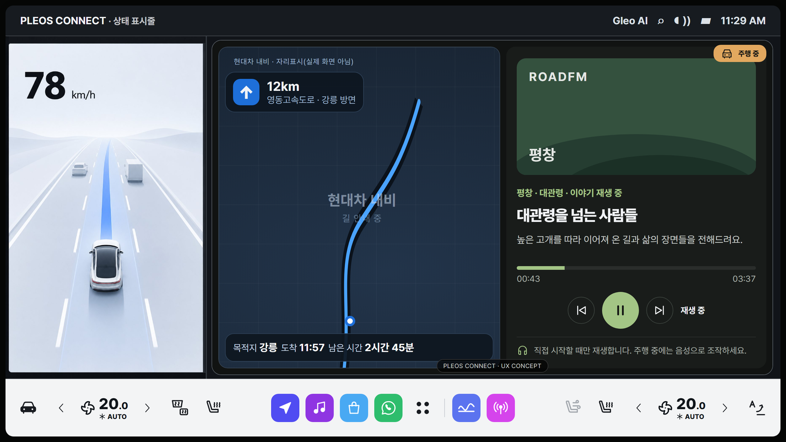
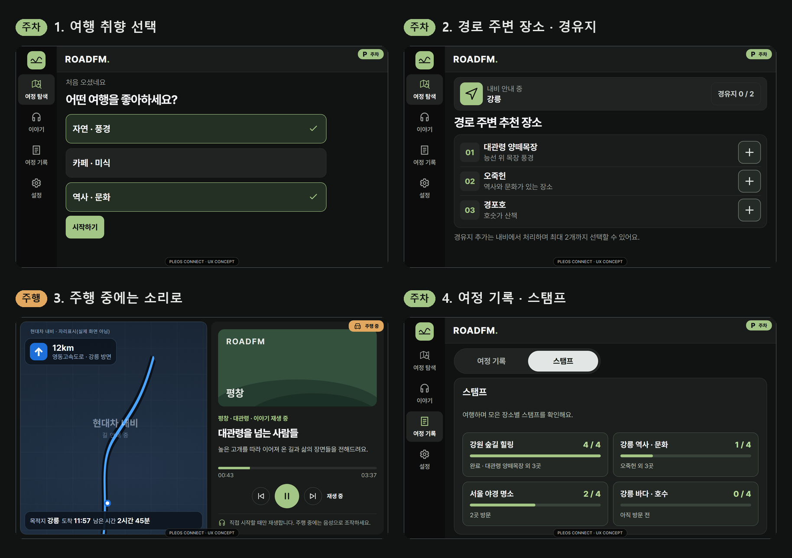
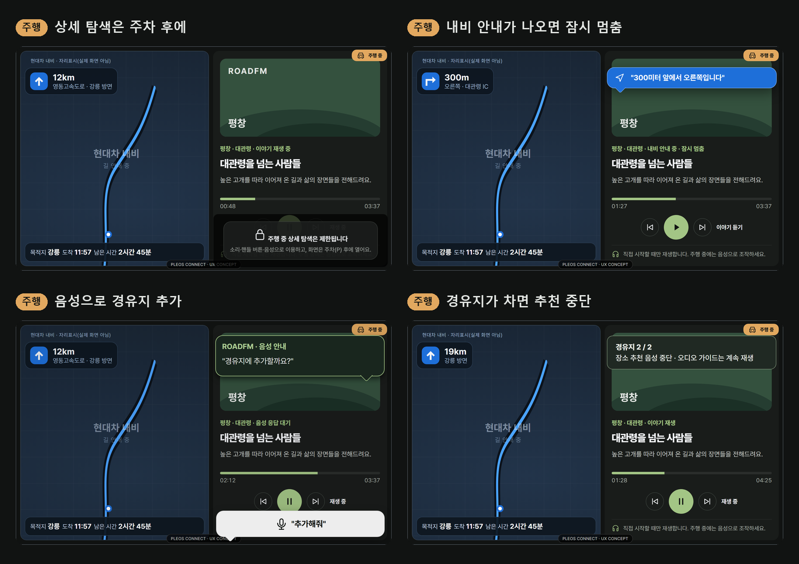

# ROADFM (로디엠)

**지나가는 길마다, 새로운 이야기가 흐르다.**

ROADFM은 Pleos Connect 차량에서 동작하는 **위치 기반 오디오 여행 채널**입니다.
길 안내는 현대차 내비가 맡고, ROADFM은 지나가는 지역의 역사·문화·장소 이야기를 들려줍니다.



| 시연 영상 | 차량 앱 APK | UX 프로토타입 |
|---|---|---|
| _(링크)_ | [`apk/roadfm-release.apk`](apk/roadfm-release.apk) | [`ROADFM_prototype_final.html`](prototypes/prototype2/ROADFM_prototype_final.html) |

---

## 해결하려는 문제

1. 목적지로 이동하는 동안 지나가는 지역의 역사·문화·장소를 알기 어렵고, 운전 중에는 직접 검색할 수도 없습니다.
2. 내비게이션은 거리와 시간 중심이라, 취향에 맞는 곳을 경유할 기회를 알려주지 않습니다.
3. 여행이 끝난 뒤 어디를 들렀는지 정리하려면 따로 기록해야 합니다.

ROADFM은 이동 시간을 **듣기 → 발견 → 방문 → 기록**으로 이어지는 하나의 여행 경험으로 바꿉니다.

## 설계 원칙: 주행 중에는 귀로, 주차 중에는 눈으로

| 상태 | 사용자가 하는 일 | 조작 방법 |
|---|---|---|
| 주행 중 | 이야기 듣기, 멈추기, 넘기기, 경유지 추가 응답 | 미디어 버튼, 음성, 최소화된 재생 화면 |
| 주차 중 | 취향 설정, 경로 주변 장소 탐색, 여정 기록과 스탬프 확인 | ROADFM 앱 화면 |

ROADFM은 목적지를 다시 입력받지 않습니다. 사용자가 현대차 내비에 입력한 목적지를 받아 이 길에 맞는 이야기를 준비합니다.

---

## 사용 흐름



1. **여행 취향 선택** — 처음 한 번, 좋아하는 여행 테마를 고릅니다.
2. **경로 주변 장소** — 내비 목적지를 기준으로 경로 주변 장소를 보여주고, 원하는 곳을 내비 경유지로 추가합니다(최대 2곳).
3. **주행 중에는 소리로** — 화면은 내비가 쓰고, ROADFM은 재생 정보와 기본 컨트롤 중심으로 보여줍니다.
4. **여정 기록과 스탬프** — 동의한 경우 방문한 장소가 기록되고, 테마별 스탬프로 모입니다.

## 주행 환경을 위한 설계



- **사용자가 시작할 때만 재생합니다.** 목적지를 받아도 이야기를 준비만 하고, 재생은 미디어 버튼이나 음성으로 사용자가 시작합니다. 재생이 멈춘 뒤에는 위치가 바뀌어도 스스로 다시 시작하지 않습니다.
- **상세 탐색은 주차 후에 제공합니다.** 주행 중에는 탐색·설정·기록 화면을 제한합니다.
- **내비 안내를 우선합니다.** 내비 음성 안내가 나오면 이야기를 잠시 멈추고, 안내가 끝나면 이어서 재생합니다.
- **음성으로 응답합니다.** 경로 주변 장소를 음성으로 제안하고, 운전자가 "추가해줘"라고 답하면 내비 경유지에 등록합니다. 경유지가 모두 차면 제안을 멈춥니다.
- **텍스트 입력을 요구하지 않습니다.** 목적지는 내비에서 받아오고, 주행 중 조작은 음성과 버튼으로 합니다.

---

## Pleos Connect SDK 활용

| SDK | 활용 | 상태 |
|---|---|---|
| NaviHelper | 내비 목적지 조회, 목적지 변경 감지, 경유지 조회·추가·삭제 | 차량 앱에 구현 |
| Media3 (`MediaLibraryService`) | 이야기 재생, 차량 미디어 화면·미디어 버튼·음성 명령 연동, 오디오 포커스 처리 | 개발 중 |

## 구현 현황

| 구분 | 내용 |
|---|---|
| 차량 앱 | NaviHelper 연동(목적지 조회, 목적지 변경 이벤트, 경유지 추가·삭제)을 Pleos Connect 에뮬레이터에서 검증 |
| UX 프로토타입 | 취향 선택부터 주행 중 청취, 경유지 추가, 여정 기록까지 전체 사용 흐름 |
| 콘텐츠 | 한국관광공사 TourAPI 기반 경로별 관광지 데이터 수집 |
| 다음 단계 | Media3 재생과 오디오 포커스, 지역 이야기 API, 방문 기록 |

---

## 실행 방법

### UX 프로토타입

`prototypes/prototype2/ROADFM_prototype_final.html`을 브라우저(Chrome, Edge)로 엽니다. 장면이 순서대로 자동 재생됩니다.

| 조작 | 동작 |
|---|---|
| `Space` | 일시정지 / 재생 |
| `←` `→` | 이전 / 다음 장면 |
| 오른쪽 아래 `화면` 버튼 | Connect-S / Connect-W 화면 전환 |

### 차량 앱

[Pleos Connect 에뮬레이터](https://document.pleos.ai/docs/pleos-only/getting-started)에 APK를 설치합니다.

```
adb install -r apk/roadfm-release.apk
```

1. 에뮬레이터의 내비에서 목적지를 설정하고 길 안내를 시작합니다.
2. ROADFM을 실행하면 내비 목적지가 화면에 표시됩니다.
3. 내비 목적지를 바꾸면 ROADFM 화면에도 바로 반영됩니다.
4. 경유지 추가 버튼으로 내비에 경유지를 등록하고, 제거 버튼으로 삭제합니다.

현재 차량 앱 화면은 NaviHelper 연동을 확인하기 위한 화면이며, 서비스 화면은 UX 프로토타입으로 확인할 수 있습니다.

## 기술 스택

| 영역 | 기술 |
|---|---|
| 차량 앱 | Kotlin, Jetpack Compose, Pleos Connect NaviHelper SDK 3.0.5 |
| 재생 | AndroidX Media3 |
| 백엔드 | Spring Boot 3.5, Java 21, PostgreSQL + PostGIS |
| 데이터 | 한국관광공사 TourAPI |

빌드와 개발 환경 구성은 [`docs/DEVELOPMENT.md`](docs/DEVELOPMENT.md)를 참고하세요.
